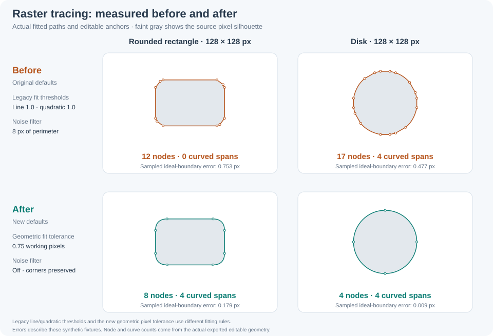

# Canvas: bitmap tracing and vector exchange

Both the idea canvas and the order drawing use these controls. Set document units and scale in **Layout → Document** first. Existing saved drawings need no database migration.

## Operator workflow

1. **Bitmaps → Trace bitmap** opens the tracing docker. Choose a local PNG/JPEG/WebP, select an existing uncropped bitmap (including a bitmap imported from PDF/EPS), or select an imported image attachment card. Choose a trace profile, background handling, working resolution and precision settings, then prepare a preview. Compare source/result side by side, as an overlay, or as an outline over the source. Both views use the same working-image coordinates. The result is ordinary editable cubic Bézier curves, including compound holes, with one undo operation. Multi-object results are grouped by default. Native bitmap tracing retains placement, size, rotation, flips, clipping, parent context, stacking order and effective opacity; source replacement is optional. Attachment cards trace their original image into new artwork beside the card at the requested width, keeping the card and its file link.
2. **File → PDF / EPS / DXF** opens vector exchange. PDF import selects one page and retains its physical size. **Automatic · preserve appearance** keeps editable paths when supported; pages with unsupported effects or live text become a clearly labelled bitmap at the selected 72/150/300/600 DPI. Choose **Editable curves** to retain supported vectors and inspect omissions, or **Rendered page** to force a bitmap. Enable **Outline text on the OMS server** for glyph outlines. EPS uses the same conversion service automatically. Choose another page to import additional pages. This is separate from attaching the original PDF to an order.
3. DXF accepts ASCII and binary files. Choose a font (including a local TTF/OTF/WOFF/WOFF2) for editable text outlines; review the substitution warning. For 3D DXF choose Top (XY), Front (XZ), or Side (YZ). Strict 2D remains the default. Projection drops depth and does not remove hidden edges.
4. **Object → Fill & outline (F12)** changes fill, outline color and physical outline width. For CAD curves, left-clicking a palette swatch sets fill and right-clicking sets outline. Paint is saved with the curve and survives node edits, shaping and combine/break-apart. Filled holes remain holes for hit testing as well as rendering.
5. **Create geometry & text → Polygon / star** creates regular polygons or stars with 3–64 points, diameter, rotation and inner-radius ratio. **Edit curves & shapes → Fillet / chamfer** offers all corners of one convex closed straight contour, or a selected node between straight segments. The selected-node workflow supports open paths, concave corners and compound curves, preserves the original object in place, and provides a close-up review with a 0.005 mm circular-fillet tolerance. Excessive dimensions and other segments crossing the corner edit region are rejected. See [selected-node corners](cad-drafting.md#selected-node-fillets-and-chamfers) for the remaining limits.
6. PDF/EPS export offers selection or all drawing objects and a review of omissions. It writes vectors at full physical size, independently of zoom and document scale, with a tightly fitted page. Convert live text to outlines first. DXF export retains its existing analytic circles/arcs/ellipses and SPLINE/polyline options. Positive-weight rational splines of degree 1–5, including periodic/non-clamped curves over their active knot interval, can be imported; their polyline approximation has a convex-hull deviation bound of 0.002 mm in physical document units.

Additional familiar keys: F5 freehand, F6 rectangle, F7 ellipse, F8 text, F10 nodes, F12 fill/outline, F3 zoom out, F4 fit drawing and Shift+F2 fit selection. Existing Ctrl+Q/L/K/D workflows remain available (browser-reserved shortcuts also have menu commands).

## Supported exchange and explicit limits

This is **not** universal CorelDRAW / prepress format compatibility. The review must be checked before production.

| Format / feature | Implemented | Limits shown to the operator |
|---|---|---|
| Raster tracing | Local worker, mono or 2–32 colors, direct cubic Bézier fitting, smooth handles, sharp-corner preservation, shared color boundaries, holes, explicit pixel tolerance and small-contour filtering | Working resolution 1024 or 2048 px on the longest side (default 2048); at most 2048 × 2048 pixels, 4096 resulting nodes / 512 contours. Fully transparent pixels stay empty. Color mode retains palette alpha; mono thresholds luminance composited over white. Removing all white removes white detail too. No centerline tracing, OCR or automatic bitmap cropping. |
| PDF import | One selected page; editable paths/transforms, fill/stroke, winding rules, dashes, caps/joins, alpha, nested clips, opaque axial and expanding/shrinking radial gradients; original-resolution RGB/RGBA/monochrome images. Automatic or forced page rendering preserves patterns, mesh gradients, groups, masks and blending through PDF.js. Standard fonts and packed CMaps are bundled locally. | Advanced effects are preserved as a **bitmap page**, not individually editable objects. Editable mode reports unsupported effects and live text; server outlining can produce text curves. Image limits: 32 megapixels, 16384 px per side, 25 MiB PNG; 64 images / 64 megapixels total per import/export. Page rendering rejects excessive DPI instead of silently downsampling. RGB output; no ICC/spot-color prepress guarantee. |
| EPS import | Ghostscript conversion, text outlining, ASCII EPS and DOS EPS with bounded PostScript section | Same vector-import limits after conversion. Font substitution aborts conversion where Ghostscript reports it. Ghostscript must be installed. |
| PDF export | Cubic curves, full size, fill/stroke, holes, dashes, alpha, nested imported clips, gradients, imported embedded rasters with alpha masks, fitted artboard | CAD geometry and supported unfilled native shapes. Live text, ordinary media/image attachments, form cards and native frame masks are reported. Imported PDF artwork retains its own clips. Circular geometry is approximated within 0.005 mm. Max page side 5080 mm. |
| EPS export | Level 3 EPS: curves, fills/outlines, holes, dashes, clips, gradients and opaque embedded rasters | EPS cannot retain alpha: transparent objects/images are reported and omitted. Same object/page limits as PDF export. |
| DXF | ASCII and binary R12/R13+ import; bulged polylines; rational and periodic splines; blocks/arrays and color inheritance; hatch boundaries and solid fills; saved dimension graphics; TEXT/MTEXT/ATTRIB and constant ATTDEF as editable glyph curves; explicit XY/XZ/YZ projection of 3D lines, polylines, polyface/polygon meshes, 3DFACE edges, splines, tilted planar entities and nested XYZ blocks. Export remains ASCII 2D. | No 3D solid modeler: ACIS 3DSOLID/REGION, modern MESH entities, thickness extrusions, fit-point-only splines, wide polylines, paperspace and full style/layer round trips remain reported. 3D import is a wire projection without depth or hidden-edge removal. Text uses the selected substitute font; MTEXT inline styles/fractions are flattened with a warning, columns/vertical layouts remain unsupported. No live text editing or SHX font engine. Pattern/gradient hatches retain boundaries with a warning. Clipped artwork and rasters remain excluded from DXF cutting geometry. |
| CDR / DWG | Attachments can remain attached to orders | No native editable import/export. |

Unsupported material is never advertised as converted. Vector import/export with omission warnings requires an explicit review checkbox. Tracing displays its approximation, resolution, topology and noise notices directly; those informational notices do not require an omission checkbox. Changes to the document, selection or relevant options invalidate prepared results. Read-only and locked objects cannot be changed. The original bitmap is kept by default. Imported clipping and gradient/image coordinates are stored with the editable paths and follow object moves, rotation, mirrors and resizing. Clipping is nondestructive; node editing changes the artwork under its mask. Region shaping/combining of clipped, gradient or raster-painted objects is blocked pending an explicit flatten/unclip workflow. Selecting an imported bitmap and using **Trace bitmap** retains its affine placement and clipping. Changing its fill to a solid color replaces the gradient/image fill.

New PDF/EPS images are stored as **private file attachments**, using existing order or Toolkit storage. The canvas snapshot holds the file ID, authenticated relative URL, original dimensions and placement; it no longer carries duplicated image pixels. Preparing a preview uploads its images. Cancelling a preview leaves uploaded resources in the existing attachment library. On a new unsaved order, images are queued with its other attachments; Save replaces local blob references only after successful upload, and removing a queued image removes its canvas shape. PDF/EPS export fetches original pixels and creates a portable embedded file; a missing original blocks export. Existing drawings with inline PNG/RGB data remain readable. The 2 MB snapshot limit still protects geometry/metadata, while the previous 1024 px / 750 KB embedded-image cap is removed. Bitmap **tracing** uses a separate, explicitly selected working resolution up to 2048 px; tracing never replaces the stored original pixels.

## Cubic raster tracing — 20 November 2026

### Accuracy controls and review

The default trace uses **2048 px**, **0.75 working-pixel tolerance**, **Preserve sharp corners**, and **0 px minimum contour length**. Smaller images are not enlarged. The review shows original and working dimensions and explicitly reports any reduction. Its source preview contains the exact decoded working pixels passed to the worker, so outline comparisons use matching coordinates even when the selected bitmap is rotated or mirrored on the drawing.

| Control | Meaning |
|---|---|
| Curve-fitting tolerance, 0.1–5 working px | Bounds fitting deviation from the thresholded/quantized pixel boundary. Lower values preserve more raster detail and generally require more nodes; higher values allow simpler curves. |
| Preserve sharp corners | Retains corners detected across multiple boundary scales. Pixel staircases on smooth forms are not automatically treated as intentional corners. Color junctions and diagonal contacts stay fixed regardless of this switch. |
| Ignore contours shorter than, 0–100 working px | Removes boundaries shorter than the selected perimeter length, including small holes. This is **not an area threshold**. Zero keeps small components. A removed outer component takes its holes with it. Actual filtering produces a review notice. |
| Background | **Keep all colors**, **Remove white at the border**, or **Remove all white**. Border removal preserves enclosed white details; all-white removal also removes those details. Mono uses the thresholded white class; color uses source pixels whose RGB channels are all at least 245. Fully transparent pixels stay empty in every mode. |
| Working resolution | Caps the longest side at 1024 or 2048 px. The tolerance and contour-length controls refer to these working pixels after resizing and thresholding/color reduction. |

The pixel tolerance does not measure fidelity to an unknown original vector design. Resizing, thresholding and color quantization can change a scanned edge before curve fitting begins. At a full-image width of 100 mm and a working width of 1000 px, a 0.75 px fitting tolerance corresponds to 0.075 mm in the horizontal direction; this excludes uncertainty already present in the raster. Use a larger source or a lower tolerance when the task needs finer boundaries, and inspect holes, lettering and narrow separations before applying.

The review reports editable objects, contours, distinct fill/opacity colors, nodes, genuinely curved segments and straight segments. A hole adds a contour, not an independent object. A cubic command with collinear handles is counted as straight. Side-by-side, overlay and outline modes share one image coordinate system; zoom and scroll inspection do not modify the prepared geometry. Overlay opacity can be adjusted to compare edges. Retracing the same source retains its inspection settings. Applying writes editable `cad-bezier` objects, optionally inside a native group, in one history operation. **Shape/F10** exposes their anchor points and handles. Existing JSON save/load, PDF cubic export and DXF degree-3 SPLINE export consume the actual saved curves. Explicit DXF polyline export remains available when required by the receiving application.

### Fitting and safeguards

ImageTracer remains pinned for raw pixel-boundary extraction and hole relationships. Its line/quadratic fitting stage is replaced by bounded cubic least-squares fitting with chord-length parameterization, refinement and adaptive subdivision. Bounded subpixel smoothing helps fit stair-stepped samples, while geometric acceptance still uses the untouched pixel boundary. Accepted curved spans are checked in both directions with adaptive flattening and continuous polyline-distance bounds. Smooth joins share tangent directions, including the closed-contour seam. Exact straight runs and intentional corners remain editable as straight geometry.

Adjacent colors reuse the same canonical fitted boundary in reverse. The topology guard checks curves flattened at 0.02 working px for new crossings, winding reversal and changed containment; this check has finite geometric precision. It retries affected shared boundaries with a tighter tolerance, then can retain their original pixel corners if necessary. The review reports this conservative fit. Small retained holes are not silently discarded to simplify the output. Diagonal contacts follow the pinned boundary extractor's connectivity and retain the exact contact coordinates.

Color reduction is deterministic and considers every retained visible pixel through a bounded histogram. In color mode, **Remove all white** excludes source pixels with every RGB channel at least 245 before palette reduction, so white cannot survive by merging with gray or consume a palette slot. Exact RGBA colors survive when they fit within the requested palette size. Otherwise weighted median-cut seeds and bounded refinement produce at most 32 RGBA palette colors. Color mode retains palette opacity; mono mode thresholds visible luminance over white. Repeated raster material fills are rejected as a trace source because tracing one tile cannot represent the full repeated artwork. Trace the original image or an explicitly flattened full pattern instead.

Processing is bounded to a 12 MiB input file, a decoded source of at most 50 megapixels, a working image of at most 2048 px per side / 4,194,304 pixels, 131,072 raw boundary points, 4096 raw contours, and 4096 saved nodes / 512 saved contours. Fitting and topology checks have independent work budgets, and the UI worker has a 30-second timeout. Cancellation, worker failure or any exceeded limit writes no partial geometry. The source bitmap is retained by default. Selected-source tracing also preserves its effective opacity through parent groups and keeps imported clipping.

Algorithm and interaction references: [Schneider's piecewise cubic fitting paper](https://lhf.impa.br/cursos/tmg/Schneider-1990.pdf), [ImageTracer options](https://github.com/jankovicsandras/imagetracerjs/blob/master/options.md), [CorelDRAW shape detail and structure](https://help.coreldraw.com/CorelDRAW/540111192/Documentation-Mac/CorelDRAW-en/CorelDRAW-Adjust-shape-detail-and-structure.html), and [PowerTRACE review modes](https://help.coreldraw.com/CorelDRAW/540111192/Documentation-Mac/CorelDRAW-en/CorelDRAW-Explore-the-PowerTRACE-dialog-box.html).

### Measured before and after

The comparison below records the initial cubic-fitting pass using identical binary rasters generated from analytic shapes: old version `7f10ef791b5f78fd43d4251e1f189f6cf8b3b70c`, cubic version `a129a50d79d27992cf7c5ae1557bb25f62f3b25f`, each with its own defaults. The old line/quadratic thresholds and the new geometric pixel tolerance have different meanings. Error is the largest independently sampled distance to the ideal shape, using 256 samples per returned segment. It describes these historical fixtures, not arbitrary customer artwork or later fitter revisions.

| Fixture | Nodes, old → new | Actually curved spans, old → new | Sampled ideal-boundary error, old → new |
|---|---:|---:|---:|
| Disk, 32 × 32 px, radius 11 | 8 → 4 | 1 → 4 | 0.6511 → 0.0173 px |
| Disk, 128 × 128 px, radius 44 | 17 → 4 | 4 → 4 | 0.4775 → 0.0093 px |
| Ellipse, 128 × 128 px, radii 46/24 | 13 → 16 | 7 → 16 | 0.5227 → 0.2538 px |
| Rotated ellipse, 160 × 140 px, radii 54/29 | 18 → 10 | 5 → 10 | 0.7911 → 0.2361 px |
| Rounded rectangle, 128 × 128 px, radius 14 | 12 → 8 | 0 → 4 | 0.7529 → 0.1788 px |

Every new join in these fixtures is tangent-smooth within numerical precision. The rounded rectangle has four exact straight spans and four cubic corners. The ordinary ellipse uses more nodes than before while reducing sampled error and eliminating angular joins; lower node count is not the sole acceptance criterion.



A complete 2048 × 2048 trace of a radius-900 disk produced 16 nodes, 16 genuinely curved spans and 16 smooth joins, without a topology fallback. One local `traceRaster` call took 1.069 seconds, including extraction, fitting and topology checks; this excludes source generation, decoding and worker transfer. Sampled radial deviation from the ideal disk was 0.1007 px. Hardware and source complexity affect runtime.

The [fixture measurements](assets/raster-trace-metrics.json) and [2048 px measurement](assets/raster-trace-2048-metrics.json) retain source hashes, options and measurement details.

## Tracing workflow and sharp corners — 20 November 2026 follow-up

### Acute corners without faceting smooth curves

Rasterized pointed tips can end in a tiny flat cap. The earlier two-scale corner detector sometimes classified that cap as a rounded edge, smoothing real triangle and star cusps. Ambiguous candidates now receive two additional, bounded scale checks: the turning angle must stabilize, and eight samples on each supporting side must fit a narrow straight strip. A perimeter guard keeps these checks local to the corner. The continuous, bidirectional error certificate against the raw pixel boundary is unchanged, as are exact shared junctions and the option to turn corner preservation off.

The following deterministic fixtures compare this correction with `a129a50d` at 0.75 px tolerance and with corner preservation enabled:

| Fixture | Nodes, before → after | Detected sharp corners, before → after |
|---|---:|---:|
| Acute triangle, 128 px image, 64 px base | 33 → 17 | 0 → 3 |
| Acute triangle, 128 px image, 12 px base | 15 → 21 | 2 → 3 |
| Five-point star, 128 px image | 38 → 51 | 8 → 10 |
| Disk, 2048 px image, radius 900 px | 16 → 16 | 0 → 0 |

Preserving previously rounded cusps can require additional nodes; this is not a blanket node-count reduction. The large disk still uses 16 smooth cubics. Regression coverage includes acute triangles, 64/128 px stars, smooth circles and ellipses, strict fitting tolerance, native-rendered letter counters, and the existing work limits. A one-pixel ring or a tiny glyph whose counter touches its outside boundary at an exact raster junction remains limited by that source geometry; fitting does not reconstruct missing image detail.

### Profiles and background handling

The shared Idea/Order tracing panel offers **Black-and-white logo**, **Fine line art**, **Color artwork**, and **Custom**. Profiles set tracing parameters only. Changing a profile keeps the selected source, background mode, working resolution, physical output width, replacement choice and grouping choice. Manual changes to tracing parameters select Custom.

| Profile | Mode and starting settings |
|---|---|
| Black-and-white logo | Mono, threshold 128, 0.75 px tolerance, corner preservation, no short-contour filtering |
| Fine line art | Mono, threshold 160, 0.35 px tolerance, corner preservation, no short-contour filtering |
| Color artwork | Color, 8 palette colors, 0.75 px tolerance, corner preservation, no short-contour filtering |

These are starting values for filled-outline tracing. The line-art profile still traces the outlines of a stroke; it does not produce a centerline or recognize lettering as text.

Background removal is independent of the profile:

| Mode | Result |
|---|---|
| Keep all colors | Keeps visible white and other retained colors. Fully transparent pixels remain empty. |
| Remove white at the border | Removes only white regions reachable from any image edge through white or fully transparent pixels. Enclosed white details remain painted objects. |
| Remove all white | Removes matching white throughout the image, including enclosed details. This remains the default and preserves the earlier global-removal behavior. |

The border flood uses four-neighbor connectivity: white pixels that touch only at a corner do not connect. In mono mode, white means visible luminance at or above the selected threshold; in color mode, it means all source RGB channels are at least 245. The mask is applied before palette reduction, so discarded exterior white cannot consume a palette entry or merge into gray. The source RGBA buffer is not modified. Border processing uses at most one byte per working pixel plus one 32-bit queue entry per pixel, within the existing 2048 × 2048 image limit.

Use **Remove all white** when white counters should become transparent holes, for example cutting outlines from a black logo. Use **Remove white at the border** when white areas inside a colored sign are intentional painted details. Keeping an enclosed white region preserves that fill, rather than silently converting it into a transparent hole.

### Source placement and applying the result

Local file traces are centered using the full image frame, including transparent margins. They no longer start at the viewport center and extend only down/right. File and attachment output use the original image's aspect ratio at the requested physical width, even when reducing the working image rounds its short side to a different proportion. Preview comparison continues to use the actual working pixels sent to the fitter.

For a selected native image or imported raster-filled CAD object, the new curves remain in the same parent and immediately above the source's sibling position. Optional replacement removes the source in the same transaction. The source's own opacity is folded into its new paint; ancestor opacity continues to come from the retained parent hierarchy. This preserves overlapping labels and nested groups. Imported clipping remains attached to the curves.

Images imported through the usual Idea/Order attachment flow are image **cards** with a header and file association. Tracing a card reads the original PNG/JPEG/WebP and creates new artwork beside it at an explicit physical width. The card remains intact. Its preview crop, header and display opacity do not become part of the artwork. The existing locked/protected/read-only guards still apply.

**Group result** is enabled by default. Two or more created objects become one native group, with each object's paint and compound holes retained. A single-object result remains one selected curve. The existing Objects tree, Group/Ungroup, Select Same and F10 tools provide further editing. Creating the curves, grouping them and optionally replacing a native source share one Undo step. Capacity, stale-source, parent and snapshot checks precede mutation, and a failed group operation rolls the transaction back.

Native group normalization can otherwise dissolve a pre-existing singleton parent during Undo and lose its opacity context. Source-relative tracing retains only those existing singleton ancestor groups in the current editor. Unrelated groups, empty-group cleanup and explicit Ungroup keep their native behavior. This protection is runtime state rather than saved metadata; a fresh editor establishes it on its next source-relative trace. Failed operations release newly installed protection after completing rollback.

Changing tracing parameters and preparing another result retains the comparison mode, zoom, opacity and inspected area for the same source. The previous preview cannot be applied while a new trace is running or after its inputs become stale. After Apply selects the output, the source controls no longer offer a trace of an invalid vector selection. A previously chosen local file remains available without another upload.

Behavior references: CorelDRAW [trace profiles](https://help.coreldraw.com/CorelDRAW/540111192/Documentation-Mac/CorelDRAW-en/CorelDRAW-Choose-a-trace-type-and-profile.html), [background scope and grouped completion](https://product.corel.com/help/CorelDRAW/540111186/Documentation-Windows/CorelDRAW-en/CorelDRAW-Finetune-traced-results.html), and [source-image retention](https://help.coreldraw.com/CorelDRAW/540111192/Documentation-Mac/CorelDRAW-en/CorelDRAW-Prepare-the-image.html). The specific flood connectivity, thresholds, fit tolerances and resource limits above are OMS implementation choices.

### Follow-up verification

The CAD/canvas regression set passes **1,249 tests in 86 files**, including **270 isolated native Editor/React/DOM tests** and **47 new tests** in this follow-up. Targeted coverage includes 27 fitter tests, 13 background/options tests, 21 native output/group/history tests and 20 tracing-control/source tests. The attachment scenarios use actual Idea and Order card factories and native box geometry; the card's PDF/Svelte visual components are omitted from the DOM harness.

The first broad run exposed a pre-existing Freehand harness race: a fixed 40 ms wait could observe a collected pointer endpoint before the next animation frame published its preview. A delayed-frame probe reproduced it with both `a129a50d` and current production sources. The harness now awaits two actual animation frames, with all assertions retained. The affected 38-test suite and both delayed start/end closure probes pass; no Freehand production behavior changed.

Svelte/TypeScript checking reports zero errors and the same 13 pre-existing warnings in five unrelated Svelte files. ESLint passes for all 17 changed/new TS/TSX files, and the static UI scan reports no findings. The production build completes successfully with the existing SvelteKit Node adapter. Source/test hashes are held fixed across validation and publication.

Playwright discovery finds 61 scenarios in six files; they were **not executed** because of the previously observed browser URL security restriction. Native Editor/DOM results do not establish browser pixel layout, production persistence or physical cutting accuracy. No production service is restarted by this source change.


## Deployment

Docker production images now install `ghostscript`. For the existing Debian/Ubuntu systemd host, install its maintained distribution package before using EPS or PDF text outlining:

```sh
sudo apt-get update
sudo apt-get install ghostscript
gs --version
npm ci
npm run build
sudo systemctl restart reclame-oms.service
```

Keep Ghostscript patched. Conversion is authenticated and limited to the existing Toolkit manager roles. Input bytes are capped at 12 MiB while streaming; conversion has a 20-second timeout, a 20 MiB output cap, a maximum of two concurrent processes per OMS process and a per-user throttle. Ghostscript runs with SAFER, fixed flags, no shell, a minimal environment, and a private temporary directory removed on completion/failure. It does not receive application credentials or remote URLs. Missing Ghostscript returns an actionable 503; PDF path-only import and tracing still run locally. Retain `BODY_SIZE_LIMIT=32M` and the existing private Storage bucket policies for image imports. No new database migration is required.

## Verification

The tracing expansion adds focused coverage in `cad-trace-fit.test.ts`, `cad-trace-precision.test.ts`, `cad-trace-raster.test.ts`, `cad-trace-topology.test.ts`, `cad-trace-client.test.ts` and `drawing-raster-trace.test.tsx`. These cover the raw-boundary fitting budget in both directions, smooth closed seams, preserved corners and exact straight sides, high-resolution node/work limits, shared color boundaries and junctions, holes and narrow gaps, explicit white/noise controls, deterministic RGBA reduction, actual Store/History/JSON persistence, parsed cubic DXF/PDF exports, worker cleanup, aligned preview controls, source transforms/opacity/clipping, stale/read-only/cancel handling, and single-step Undo. The UI tests use actual Editor/React/JSDOM with mocked decoding and worker transport; they do not claim browser rendering or hardware validation.

The completed 20 November 2026 tracing pass passed **1202 tests across 84 CAD/canvas files**, including **73 new tests** and **243 tests in isolated Editor/React/DOM suites**. `npm run check` reported zero errors and the same 13 existing warnings in five unrelated files. ESLint passed for all 17 changed/new TypeScript files, the UI static scan reported no findings, and the production build passed. The first build was terminated while temporary compiled test modules occupied 4.6 GiB; removing those reproducible modules and running the build separately with a 4 GiB Node heap resolved the environment constraint. Source and test hashes remained unchanged through final verification. Browser discovery found the existing 61 scenarios in six files; they were **not executed** because browser access to the local fixture was blocked. No production service was restarted in this pass.

`tests/unit/cad-vector-exchange.test.ts` verifies synthetic bitmap holes, quadratic-to-cubic controls, alpha handling, native-store persistence, fill/hole hit testing, read-only/stale/bound-source protections, physical dimensions at 1:10, PDF.js parsing of exports, actual Ghostscript EPS conversion and PDF text outlining, omission warnings, polygons, corners, and rational spline deviation. The CI workflow installs Ghostscript for these tests. `cad-external-import.test.ts` uses committed DXFs generated by **ezdxf 1.4.5**, not the OMS exporter, including independent periodic-spline samples. `cad-artwork-exchange.test.ts` renders PDF and EPS using actual Ghostscript and checks colors, clipping holes, gradient transforms, image orientation and alpha. It also tests an independently authored EPS through server conversion → editable import → export, native-store persistence, unsafe paint rejection and the snapshot budget. `cad-dxf-expanded.test.ts` checks independent R12/R2010 binary fixtures, glyph placement/attributes and nested 3D projections against ezdxf coordinates. `cad-raster-assets.test.ts` verifies a 2048×1024 noisy image larger than 750 KB, lossless full-resolution export, private reference validation and new-order save mapping. `cad-pdf-appearance.test.ts` compares real PDF.js rendering of patterns, transparency groups and blending against Ghostscript pixels and verifies standard-font rendering without system fonts. Browser interaction and live private Storage are still deployment acceptance checks. The fixture generator is development-only; Python/ezdxf are not runtime dependencies.

DXF implementation references: Autodesk [boundary path data](https://help.autodesk.com/cloudhelp/2024/ENU/AutoCAD-DXF/files/GUID-DC5215D6-E73F-4DFF-8BE9-01CA9610FAEE.htm), [INSERT](https://help.autodesk.com/cloudhelp/2017/ENU/AutoCAD-DXF/files/GUID-28FA4CFB-9D5E-4880-9F11-36C97578252F.htm), and [HATCH](https://help.autodesk.com/cloudhelp/2024/ENU/AutoCAD-DXF/files/GUID-C6C71CED-CE0F-4184-82A5-07AD6241F15B.htm).

```sh
node packages/vitest/bin.js tests/unit/cad-vector-exchange.test.ts
npm test
npm run test:unit
npm run check
npm run build
```

Before replacing CorelDRAW in production, run the [canvas acceptance procedure](canvas-acceptance.md) with your own representative logo and PDFs/EPS/DXFs. Compare fonts, holes, fills, stroke widths and full-size dimensions in the actual receiving application. Current automated fixtures do not prove fidelity for arbitrary client artwork.

Additional Autodesk references: [binary DXF](https://help.autodesk.com/cloudhelp/2025/ENU/AutoCAD-DXF/files/GUID-FC1C3C69-DBC2-49E4-893A-000D6538C0FE.htm), [TEXT](https://help.autodesk.com/cloudhelp/2020/ENU/AutoCAD-DXF/files/GUID-62E5383D-8A14-47B4-BFC4-35824CAE8363.htm), [MTEXT](https://help.autodesk.com/cloudhelp/2020/ENU/AutoCAD-DXF/files/GUID-5E5DB93B-F8D3-4433-ADF7-E92E250D2BAB.htm).
